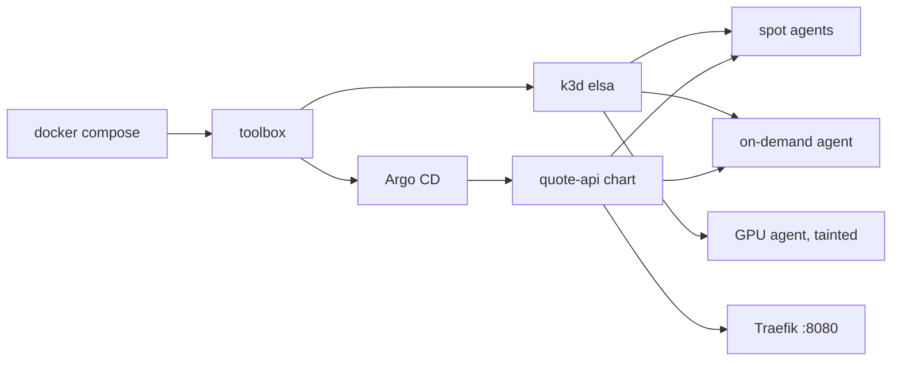
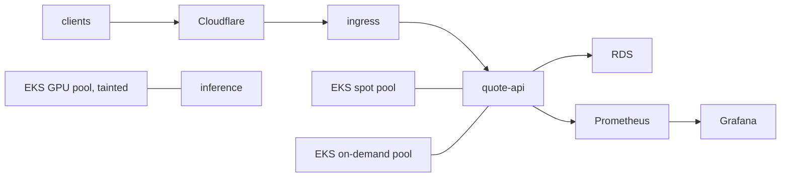

# ELSA_DevOps

Quote API on a local k3d cluster, deployed by Argo CD from this repo.

## Quick start

```bash
git clone https://github.com/yudantara99r/ELSA_DevOps.git && cd ELSA_DevOps
docker compose up -d
./scripts/run-all.sh
```

`docker compose up -d` returns as soon as the toolbox container is up. The cluster is created by the script, which is safe to run again.

When it finishes:

```bash
curl http://localhost:8080/api/quote
```

Grafana is at http://grafana.localhost:8080. The admin password is the `admin-password` key in the `kube-prometheus-stack-grafana` secret in the `monitoring` namespace.

`run-all.sh` includes a load test of about two and a half minutes, then waits for the HPA to settle back at 3 replicas. That wait can take several minutes. It is the HPA scale-down window, not a hung script.

## Architecture



Compose starts one toolbox container and gives it the Docker socket. The toolbox creates a k3d cluster named `elsa`: one server and four agents, k3s `v1.37.2`. `troubleshoot/prepare.sh` labels two agents spot, one on-demand, and one GPU, and taints the GPU node `nvidia.com/gpu=true:NoSchedule`.

Argo CD syncs `charts/quote-api` from this repo. The app prefers spot, must stay on spot or on-demand, and does not tolerate the GPU taint. Traefik publishes host port 8080 to the ingress.

The same shape on AWS:



Karpenter manifests for the GPU pools are in `karpenter/gpu.yaml`. They are not applied to k3d. Cloudflare DNS and cache rules are in `cloudflare/` and are validated, not applied. The local service does not use a database. RDS is the production store for state this process does not keep.

## Scripts

`run-all.sh` runs these in order. Each one is safe to run on its own.

| Script | What it does |
| --- | --- |
| `00-bootstrap.sh` | Creates the k3d cluster if needed, then labels and taints the nodepools. |
| `10-build-image.sh` | Builds `quote-api` on the host. Not part of `run-all`. |
| `20-deploy.sh` | Installs Argo CD and lets it sync the chart. Checks that 3 replicas land 2 spot and 1 on-demand. |
| `25-reclaim-drill.sh` | Drains one spot node and checks the replacement stays on the other spot node while curl keeps working. |
| `30-troubleshoot.sh` | Applies the fixed manifests and runs the provided `verify.sh`. |
| `50-validate-tf.sh` | `terraform fmt -check`, `init -backend=false`, and `validate`. No Cloudflare token. |
| `40-observability.sh` | Installs kube-prometheus-stack and scrapes `/metrics`. Runs after the app namespace exists. |
| `60-loadtest.sh` | Runs k6 through the ingress, requires the HPA to pass 3 replicas, then waits for scale-down. |

`20-deploy.sh` builds the chart's image tag locally when that tag is not already in the engine, and imports it into k3d. A local run does not need GHCR. CI publishes `ghcr.io/<owner>/quote-api:<git sha>` with no `latest` tag.

## Decisions

- k3d, not kind. k3s enforces NetworkPolicy, so Part 3 does not need Calico.
- One Deployment. The HPA runs 3 to 6 replicas at 70% CPU. Required affinity excludes the GPU node and the control plane. Spot is preferred, so a drained spot pod is replaced on the other spot node. Capacity spread is hard (`maxSkew` 1), which keeps the counts of spot and on-demand within one of each other. Hostname spread is soft, because a cordon is not a taint and a hard per-node spread leaves the replacement Pending.
- Argo CD deploys the app. Helm installs only Argo CD and kube-prometheus-stack. The ServiceMonitor is applied after those CRDs exist, so the first app sync does not fail on a missing CRD.
- The API is Python stdlib, about 100 lines, non-root, read-only root filesystem. `/api/quote` burns CPU for 100ms so the load test shows up in CPU metrics. Quotes are original.
- CI is GitHub Actions: unit tests, Semgrep, Trivy, then a SHA-tagged push and a keyless cosign signature on main. It does not deploy and it does not keep a kubeconfig. The legacy GitLab file is unchanged. See `MIGRATION-NOTES.md`.
- Cache rules use a zone ruleset (`http_request_cache_settings`), not page rules. `/api/*` is not cached. Static assets are.
- Alertmanager is off. Prometheus still evaluates `QuoteApiErrors`. Control-plane scrapes that k3s does not expose are off. OpenTelemetry is out. The load-test numbers and the reason for the alert are in `LOADTEST.md`. The broken-manifest write-up is `TROUBLESHOOTING.md`.

## If something fails

**Port 8080 or 6550 is taken.** The ingress is published on 8080 and the API on 6550. Free the port and run `./scripts/run-all.sh` again. Bootstrap will not delete an existing cluster.

**An image pull sits until the rollout fails.** Argo CD and Grafana images are large. On a slow link one agent can stall the pull and the Deployment hits its progress deadline. Run the same script again. The layers already pulled are reused, and the pod comes up on another node. Grafana at a 256Mi limit is OOMKilled during startup. The values file sets 768Mi.

**The engine runs out of memory.** Five k3s nodes plus the monitoring stack need several GB. If pods stay Pending with insufficient memory, raise the Docker VM memory and re-run. Do not drop the agent count. The nodepool layout needs four workers.

If `./scripts/run-all.sh` is permission denied, the executable bit was lost in transit. `sh scripts/run-all.sh` is the same entrypoint.
